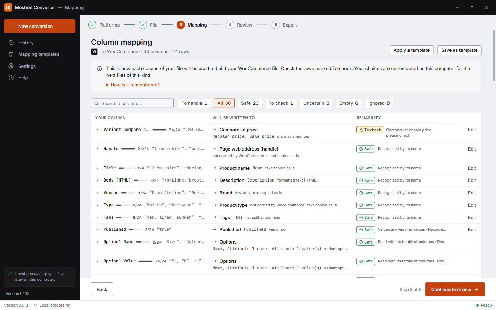
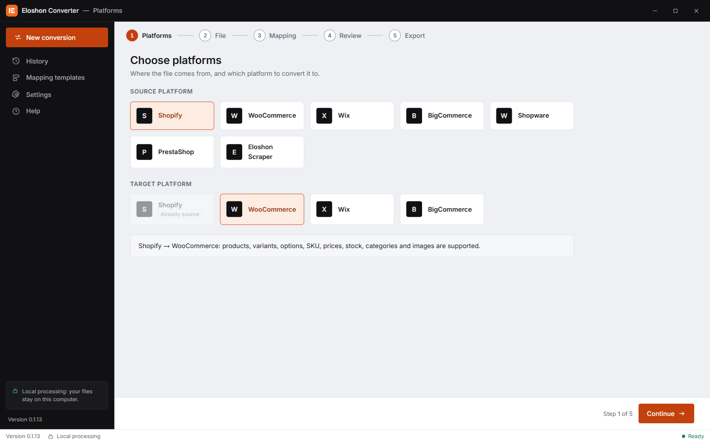
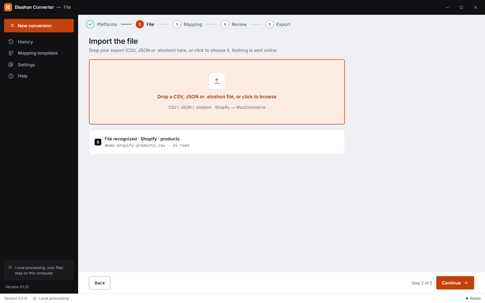
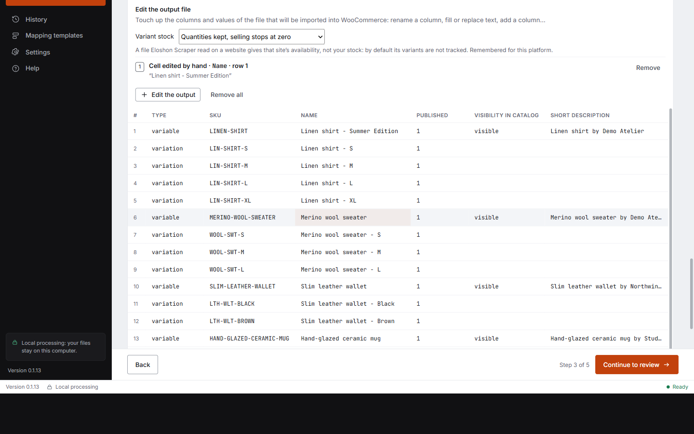
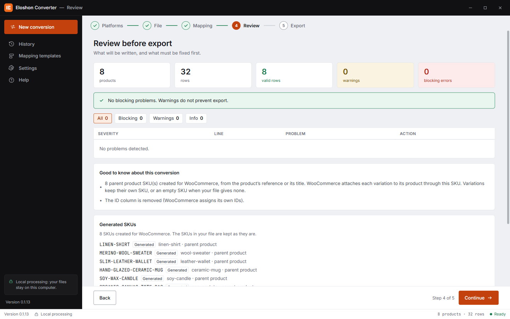
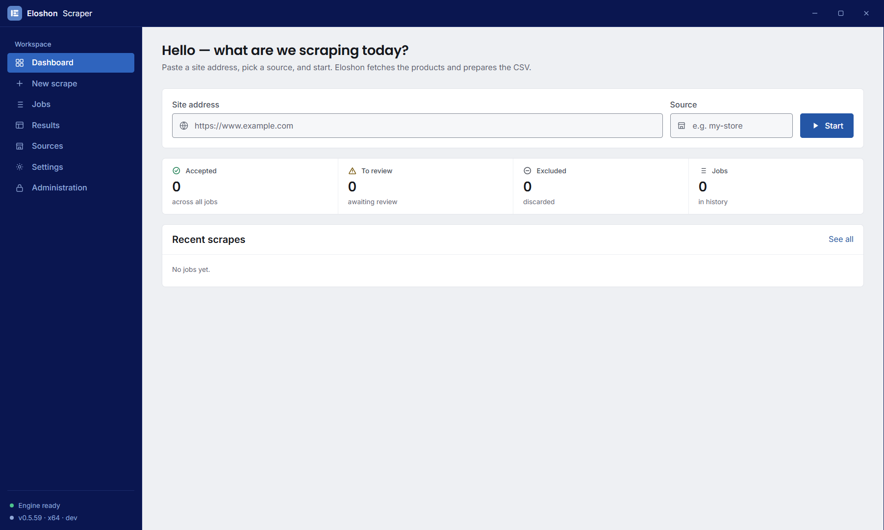

# Eloshon — web product scraper & e-commerce catalog converter

[Français](README.fr.md) · **English**

> **Source-available, free for noncommercial use** ([PolyForm Noncommercial 1.0.0](LICENSE)).
> Personal use, study, research, education and non-profits are welcome. **Commercial use requires a written licence** — see [Licensing](#licensing).

Eloshon is two Windows desktop apps that cover the whole road from *"I need this product data"* to *"it is imported in my shop"*:

| App | In one sentence |
|---|---|
| **Eloshon Scraper** | Collects product data (name, price, images, variants, stock, reviews…) from websites, with a Chrome/Edge extension that learns a site's layout from one example you point at. |
| **Eloshon Converter** | Reads a product file (supplier CSV, shop export, JSON, Scraper export) and writes the exact **import file** of **Shopify, WooCommerce, Wix Stores or BigCommerce** — mapping, formulas and manual fixes included. All processing is local. |

<p align="center">
  
</p>

**Typical jobs**: migrate a shop from PrestaShop/Shopware/Wix to Shopify/WooCommerce · load a supplier catalog (BigBuy…) into your shop · turn a scraped site into an import file · repair an export that a platform refuses to import.

## Table of contents

- [Eloshon Converter](#eloshon-converter)
- [Eloshon Scraper](#eloshon-scraper)
- [Quick start](#quick-start)
- [How it works](#how-it-works)
- [Repository layout](#repository-layout)
- [Tests](#tests)
- [Contributing](#contributing--help-wanted)
- [FAQ](#faq)
- [Licensing](#licensing)

---

## Eloshon Converter

Catalog files are messy: different column names per platform, per language, per supplier; prices in cents, sizes as free text, images in one cell separated by commas, variants as flat rows. The Converter turns that into a clean import file in four steps — **platforms → file → mapping → check → export**.

**What it does**

- **Detects the format** of the file you drop (Shopify, WooCommerce, Wix, BigCommerce, PrestaShop, Shopware, BigBuy, Eloshon Scraper…), including column headers in several languages (French, English, Dutch, Spanish…) and localised WooCommerce exports. An unknown layout can be **learned once and remembered**.
- **Maps columns** with an automatic proposal and a confidence level per column; you confirm, change or ignore each one. Mappings can be saved as reusable **templates**.
- **Formulas** (spreadsheet-style, ready made): replace, remove, cut, prefix/suffix, split, regex, number operations (e.g. cents → euros), slugify, strip HTML, join columns, fill empty cells… applied **before** conversion (on the source) or **after** (on the file that will be imported).
- **Edit any output cell by hand** in the preview table before exporting.
- **Understands product structure**: options and variants, colour pages grouped into one product with a colour axis, images per variant, categories (and Shopify collections via tags), SKU rules that never invent a reference the source did not give, weight units and price formats.
- **Reports what it did**: every value that could not be carried to the target platform is listed (nothing is silently dropped), with a check step before export.
- **Local and private**: no catalog is uploaded. Interface in French, English, Dutch and Spanish.

**Platforms** — reads Shopify, WooCommerce, Wix, BigCommerce, PrestaShop, Shopware, BigBuy and Eloshon Scraper exports; writes Shopify, WooCommerce, Wix Stores and BigCommerce import files. Customers and orders are covered for the platforms listed in [`converter/docs`](converter/docs). The exact list of conversion directions lives in [`converter/core/directions.mjs`](converter/core/directions.mjs).

### Screenshots

The five steps, on a small synthetic Shopify catalog converted to WooCommerce.

| 1 · Choose platforms | 2 · Drop your file — format recognised |
|---|---|
|  |  |
| **3 · Map the columns** | **3 · Edit any output cell by hand** |
|  |  |
| **4 · Review before export** | **Eloshon Scraper** |
|  |  |

## Eloshon Scraper

A scraper that does not need a hand-written script per website.

- **A real browser does the work.** The Chrome/Edge/Brave extension runs in *your* browser (your IP, your session), so pages render and log in like for a human. The desktop app holds the engine, settings, storage and exports.
- **Teach, don't code.** Point at a product on a page (🎯): the app learns the layout (listing cards, fields, prices, variants, pagination) and applies it to the whole site. Learned rules are saved per site.
- **Several ways to read a page**, chosen from the data: replay of the site's own JSON API · embedded page state (`__NEXT_DATA__`, JSON-LD, microdata) · DOM selectors · scripted actions (click, scroll, paginate) · listing → detail pages.
- **Polite and resilient**: adaptive per-domain pacing, challenge/bot-wall detection, resumable jobs with de-duplication.
- **Optional paid fallbacks**: when a site blocks a plain browser, the app can escalate to a paid unblocking provider **using your own API key** (stored locally, never in this repository).
- **Rich output**: products with images, variants, stock per size, reviews, category trail — as `products.json` / CSV, ready for the Converter.

> Use the Scraper in line with each site's terms of use, `robots.txt` and the law. You are responsible for how you use it.

---

## Quick start

Requirements: **Windows 10/11**, **Node.js 20+** (22 LTS recommended), npm, Git.

```bash
git clone https://github.com/Eloshon-1040/Eloshon.git
cd Eloshon

# Converter
npm --prefix converter ci
npm --prefix converter start

# Scraper
npm ci
npm run pw:install        # downloads Chromium for Playwright (once)
npm start
```

Build installers yourself (NSIS `.exe`):

```bash
npm --prefix converter run dist     # Eloshon Converter
npm run dist:win                    # Eloshon Scraper
```

**Load the extension** (developer mode): run `npm run ext:build`, open `chrome://extensions`, enable *Developer mode*, choose *Load unpacked* and select the `extension/` folder. See [`docs/EXTENSION.md`](docs/EXTENSION.md) for the pairing with the app.

## How it works

**Converter pipeline**

```
 file ──► detect format ──► parse ──► column mapping ──► canonical product model ──► serialise for the target ──► import file
          (reference +      (CSV/JSON   (rules, semantic     (variants, images,         (Shopify / Woo / Wix /      + report of
           learned formats)  encodings)  guesses, your fixes)  categories, SKUs)         BigCommerce columns)        what changed
```

The engine is pure TypeScript in [`converter/core/src`](converter/core/src) (transpiled to ESM by `npm --prefix converter run build:engine`, no bundler); the Electron shell is in [`converter/app`](converter/app). Platform formats are described as data in [`converter/core/knowledge-ref`](converter/core/knowledge-ref); formats you teach it are stored on your machine only.

**Scraper architecture**

```
desktop app ── named pipe ── native host ── native messaging ── extension (MV3)
 engine, config,             thin relay,                         service worker + in-page runner
 storage, exports            validates messages                  drives a real tab
```

Recipes, extractors, pacing and challenge logic live once in [`shared/`](shared) and are used by both the app and the extension. Details: [`docs/EXTENSION.md`](docs/EXTENSION.md), [`docs/archetypes-and-limits.md`](docs/archetypes-and-limits.md), [`docs/VARIANTS.md`](docs/VARIANTS.md).

## Repository layout

| Folder | What is inside |
|---|---|
| `converter/core` | Conversion engine (TypeScript) and format knowledge |
| `converter/app` | Eloshon Converter — Electron app (main, preload, renderer) |
| `app/`, `core/` | Eloshon Scraper — Electron app and extraction engine |
| `shared/` | Code shared by the Scraper app and the extension (recipes, DSL, pacing, extractors) |
| `extension/`, `native-host/` | Chrome/Edge extension (Manifest V3) and its native-messaging bridge |
| `supabase/` | Schema and edge function of the optional hosted service |
| `docs/` | Technical notes |

## Tests

```bash
npm --prefix converter test    # builds the engine, then runs the Converter suite (formats, golden files, UI strings)
npm test                       # Scraper, extension, native host — build the Converter engine first
```

The Converter keeps **golden files** (`converter/test/golden`): the exact expected output for each source → target pair. A change that alters an output must update them on purpose. `npm run smoke:live` and the `verify-*` scripts hit real networks — run them knowingly.

## Contributing & help wanted

Help is very welcome, whatever your level. Good places to start:

- **Import formats** — a platform export that is mis-read, a column that lands in the wrong field. Add a small *synthetic* sample file and a test.
- **Translations** — the interface is in French, English, Dutch and Spanish (Scraper also German); typos and missing languages.
- **Bug reports with a minimal example** — see the [issue templates](../../issues/new/choose).
- **Tests and documentation.**

Read [CONTRIBUTING.md](CONTRIBUTING.md) first: it explains the workflow, the contribution agreement and `git commit -s`. Look for issues labelled **good first issue** and **help wanted**. Never post API keys, personal data or a real customer catalog.

Security problem? **Do not open a public issue** — see [SECURITY.md](SECURITY.md).

## FAQ

**Is this open source?** It is *source-available*: you can read, run and modify the code for noncommercial purposes. It is not "open source" in the OSI sense because commercial use is restricted.

**Can I use it for my own online shop?** A shop is a commercial activity, so a commercial licence is needed. Personal projects, learning, research, schools and non-profits are free.

**Can I use it to convert catalogs for clients?** That is commercial use — contact us for a licence.

**Does my catalog leave my computer?** The Converter works locally. The Scraper talks to the sites you scrape and, if you enable them, to the paid providers you configured with your own keys.

**Which keys are needed?** None to run the Converter or the basic Scraper. Optional services (unblocking providers, AI help) use keys you enter in the app.

**Is there a ready-made installer?** Not yet in this repository — build it with the commands above. Releases may follow.

## Licensing

Copyright (c) 2026 Eloshon. Licensed under the [PolyForm Noncommercial License 1.0.0](LICENSE).

- **Free**: personal use, hobby, study, research, teaching, charities, public institutions — including modifying and sharing the code for those purposes, keeping the licence and the `Required Notice` line.
- **Needs a licence**: using it for a business, a shop, a client project, a paid service or product. See [COMMERCIAL-LICENSE.md](COMMERCIAL-LICENSE.md) or write to **team@eloshon.com**.

Third-party dependencies keep their own licences. *Keywords: product scraper, e-commerce scraping, CSV converter, Shopify CSV import, WooCommerce import, Wix Stores import, BigCommerce import, PrestaShop to Shopify migration, Shopware migration, supplier catalog import, Electron.*
